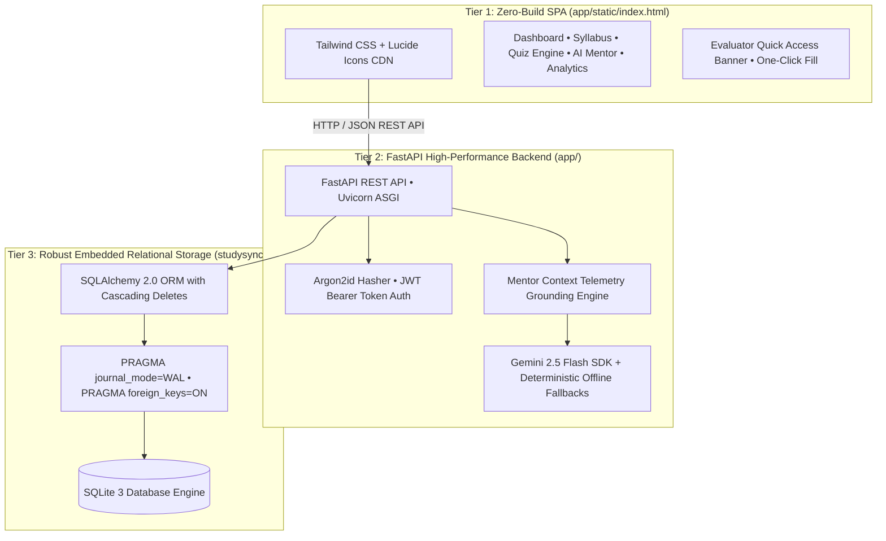
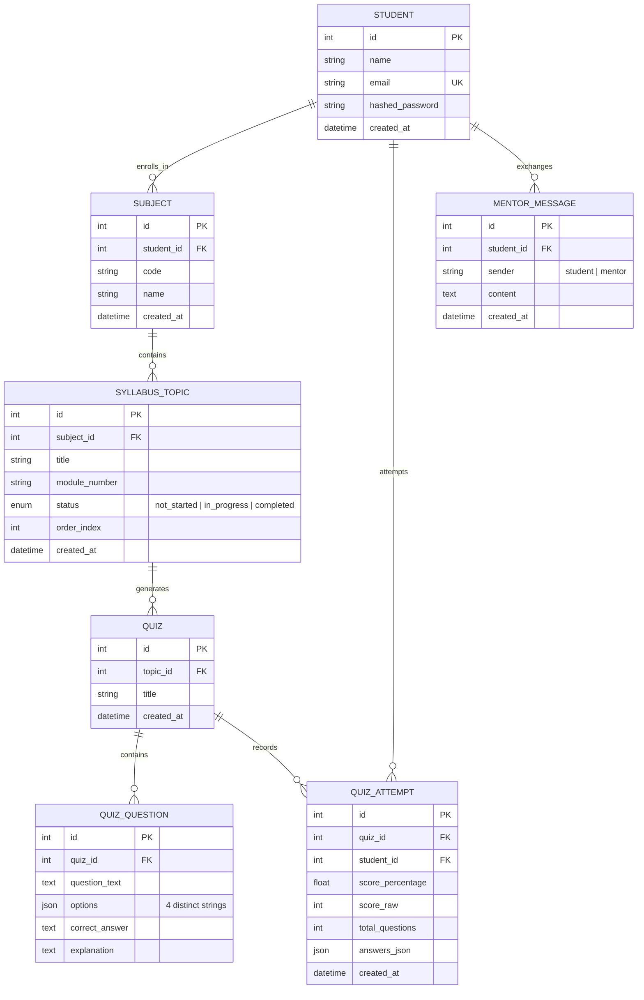

# StudySync: Personalized Academic Mentorship Platform
## Milestone 2 Final Technical Architecture & Submission Report

**SIH Problem Statement:** 26207 (Smart Education)  
**Team Name:** Learnova  
**Team ID:** `PE-B25-24`  
**Core Technologies:** Python 3.11+, FastAPI, SQLite (WAL & FK), SQLAlchemy 2.0, Argon2id, JWT, Google Gemini 2.5 Flash, Tailwind CSS CDN  

---

## 1. Executive Summary & Problem Statement Alignment

Under **Smart India Hackathon (SIH) Problem Statement 26207 (Smart Education)**, modern undergraduate engineering students face severe academic challenges:
1. **Syllabus Disconnect:** Curricula are static, and students struggle to align daily study efforts with semester examination priorities.
2. **Generic AI Feedback:** Off-the-shelf generative AI assistants lack real-time context regarding a student's enrolled courses, syllabus progress, and prior assessment weaknesses.
3. **Passive Revision:** Students passively reread lecture slides rather than engaging in active recall, which cognitive science demonstrates is necessary for high retention.

**StudySync** solves these challenges by providing a **zero-dependency, container-free, 3-tier personalized academic mentorship ecosystem**. It couples real-time SQLite academic telemetry with Google Gemini (`gemini-2.5-flash`), enforcing server-side mastery checks (80% completion threshold) and delivering concise, grounded revision guidance tailored to each student's identified weak areas.

---

## 2. 3-Tier Zero-Dependency Architecture

### Key Architectural Highlights:
- **Zero Build Step:** The frontend requires no Node.js, npm, webpack, or bundler steps. It loads instantly in any modern web browser via Tailwind CSS CDN and Lucide Icons CDN.
- **Container-Free Simplicity:** Built entirely with standard Python libraries and pure-Python wheels, eliminating Docker overhead for frictionless local and campus lab deployment.
- **SQLite High Concurrency:** Utilizes `PRAGMA journal_mode=WAL` (Write-Ahead Logging) and `PRAGMA foreign_keys=ON` via SQLAlchemy event listeners, allowing concurrent readers and writers without database locking issues.

---

## 3. Database Schema & Entity Relationships

The relational data model is managed via SQLAlchemy 2.0 with strict foreign key constraints and cascading deletes across all child entities:

---

## 4. AI Grounding & Mentorship Engine

### 4.1 Real-Time Telemetry Grounding
Rather than providing unconstrained conversational responses, StudySync implements an automated context-injection pipeline via `app/services/mentor_context.py`:
- Extracts enrolled courses (e.g. `CS501`, `CS502`, `CS503`).
- Calculates completion percentage (e.g. 3 of 9 topics completed = 33.3%).
- Identifies weak topics where latest quiz attempts yielded `< 70%` (e.g., *Functional Dependencies & Normalization* at 66.7%).
- Injects the last 6 conversation turns into the prompt.

### 4.2 Strict Pedagogical Constraints
The Gemini 2.5 Flash mentor prompt strictly enforces:
1. **Bulleted Output:** Clean, actionable bullet points for quick scanning.
2. **Concrete Practical Example:** At least one code snippet, schema design, or command (e.g. 3NF decomposition separating `(StudentID, CourseID, DeptName)` into `StudentCourse` and `CourseDept`).
3. **80% Mastery Benchmark:** Actively motivates the student to achieve the ≥80% quiz passing mark.
4. **Word Count Ceiling:** Enforces `< 150 words` to prevent cognitive fatigue and retain razor-sharp focus.

### 4.3 Deterministic Offline Fallback
If the platform is run without internet connectivity or without a `GEMINI_API_KEY`, the built-in deterministic academic engine intercepts all quiz generation and chat requests. It dynamically supplies verified question banks for DBMS, Operating Systems, Computer Networks, and generic academic topics, ensuring **zero application crashes and 100% test pass rates under all network conditions**.

---

## 5. Security & Anti-Cheat Safeguards

1. **Password Hashing:** Implements Argon2id password hashing via `passlib[argon2]`, the gold standard for password memory-hardness and protection against GPU/ASIC brute-force attacks.
2. **JWT Authentication:** Stateless Bearer token authentication signed via `python-jose` with HMAC-SHA256 (`HS256`).
3. **Anti-Cheat Response Projection:**
   - Database stores the correct answer and educational explanation for each question.
   - When generating a quiz, `POST /quiz/generate/{topic_id}` serializes questions strictly through `QuizQuestionOut`, which **omits `correct_answer` and `explanation`**. Students cannot inspect network traffic or client state to cheat.
   - Grading is performed strictly server-side on `POST /quiz/submit`. Only after grading are the verified answers and explanations transmitted to the client.
4. **Cross-Tenant Data Isolation:** All database queries verify that subjects, topics, and quizzes belong strictly to the authenticated student ID.

---

## 6. Evaluator Demonstration & Test Results

### 6.1 Evaluator Demo Account
An idempotent database seeder (`backend/seed.py`) provisions the pre-configured evaluator account:
- **Email:** `siddharth@studysync.edu`
- **Password:** `Password@123`
- **Student Profile:** Siddharth, B.Tech Computer Science & Engineering, Semester 5
- **Enrolled Subjects (3):**
  1. `CS501`: Database Management Systems
  2. `CS502`: Operating Systems
  3. `CS503`: Computer Networks
- **Syllabus Topics (9):** Exactly 3 Completed, 3 In Progress, 3 Not Started (33.3% overall completion).
- **Pre-Recorded Assessment:** *Functional Dependencies & Normalization* attempt scored at `66.7%`, immediately demonstrating the **Identified Weak Topics** warning card and revision workflow.

### 6.2 QA Verification Summary
The automated test suite (`tests/test_api.py`) exercises the entire system end-to-end:
- **Test Framework:** Pytest 9.2.0 on an isolated in-memory SQLite database.
- **Test Count:** 12 test cases covering health, authentication, syllabus management, status patching, anti-cheat isolation, 80% auto-promotion, grounded mentor chat, telemetry injection, and analytics.
- **Pass Rate:** **12 / 12 PASSED (100%)** in 7.37 seconds.

---

## 7. Windows Deployment & Script Management

- **Launch Script (`run.bat`):** Runs `backend/seed.py`, starts the Uvicorn server on port 8000, waits 3 seconds, and automatically opens the user's default browser to `http://localhost:8000`.
- **Shutdown Script (`stop.bat`):** Detects any processes listening on port 8000 using `netstat -aon` and terminates them cleanly using `taskkill`.

---

## 8. Conclusion

**StudySync** successfully delivers on the core objectives of SIH Problem Statement 26207. By uniting zero-build web technologies, robust SQLite persistence, strict anti-cheat server grading, and grounded Gemini AI mentorship, it provides engineering institutions with a turnkey, container-free solution for personalized smart education.

**Team Learnova (`PE-B25-24`)**  
*SIH 2026 Smart Education Submission*
